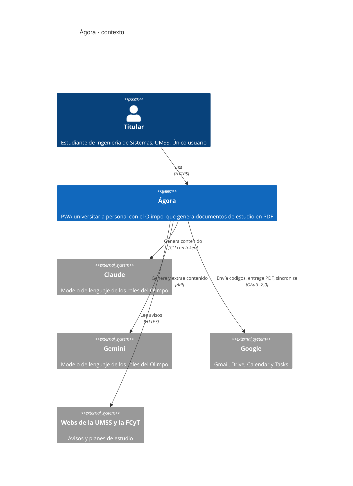
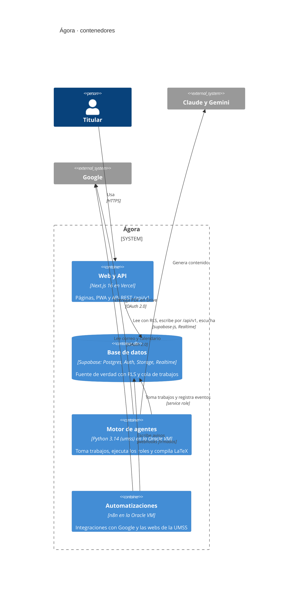

# Arquitectura · Ágora

Versión 2.3 · creado el 2026-10-20 · editado el 2026-11-01 · autor: Juan Diego Pardo Pozo

Decisiones: ADR-001 (stack web), ADR-002 (arquitectura general), ADR-003 (Olimpo), ADR-004 (render en canvas), ADR-005 (dioses y roles), ADR-006 (entorno de desarrollo aislado), ADR-007 (licencia LGPL de sharp-libvips). Rutas y API: `docs/arquitectura/api.md`. Especificación funcional original: `docs/referencia/handoff/CONTEXTO.md` (si hay diferencias, mandan los ADR).

## 1. Vista general

```
Navegador (PWA Next.js)
   │  lecturas con RLS · Realtime · escrituras por /api/v1
   ▼
Vercel ── Next.js 16: páginas (Server/Client Components) + API REST /api/v1
   │  @supabase/ssr (sesión del usuario) · service role solo en src/server
   ▼
Supabase ── Postgres (+pgvector, RLS) · Auth · Storage · Realtime · cola de trabajos
   ▲                              ▲
   │ service role                 │ service role
Oracle VM (ARM, Ubuntu)           n8n (misma VM)
 ├─ motor de agentes `umss` (systemd, hexagonal, roles como plugins)
 ├─ router de modelos Claude/Gemini · TeX Live · Chromium
 └─ métricas → metricas_vm        └─ Gmail, webs UMSS/FCyT, Calendar, Tasks → webhooks firmados
        └─► Google Drive (entregas por materia)
```

### 1.1. Contexto (modelo C4, nivel 1)

Quién usa Ágora y con qué sistemas externos se comunica. Los diagramas siguen el modelo C4 de Simon Brown y se escriben en Mermaid, que GitHub dibuja sin herramientas adicionales.



### 1.2. Contenedores (modelo C4, nivel 2)

Las piezas que se despliegan por separado y cómo se comunican. La web y el motor de agentes nunca se llaman entre sí: se coordinan por la cola de trabajos en Postgres y por Realtime.



## 2. Qué arquitectura usa cada pieza

| Pieza | Arquitectura | Detalle |
|---|---|---|
| Web (Vercel) | **Monolito modular por dominio** | `src/features/<dominio>/{ui,application,domain,infra}` con API pública en `index.ts` (ADR-002) |
| API (Vercel, dentro de Next) | **REST versionada** `/api/v1` | Handlers delgados: validar (Zod) → autorizar → caso de uso → respuesta (`docs/arquitectura/api.md`) |
| Datos (Supabase) | Postgres como fuente de verdad, con RLS | Migraciones versionadas; nunca se edita una migración aplicada |
| Motor de agentes (VM) | **Hexagonal** + registro de roles | Puertos `Cola`, `ModeloLLM`, `Almacen`, `Compilador`, `Notificador`, `RegistroEventos` |
| n8n (VM) | Flujos de integración | Solo como pegamento; escribe en Supabase o llama a webhooks firmados |

En conjunto, Ágora es un **monorepo** con un **monolito modular** (la web y su API) y un **motor de agentes asíncrono** que se comunica con ella por una cola de trabajos en Postgres. No usa microservicios: para un solo usuario agregarían despliegues y fallas de red sin ningún beneficio.

La arquitectura hexagonal se aplica **solo al motor de agentes**, que corre en la VM. El servidor web no la usa.

## 3. Estructura del monorepo

```
apps/web/                         Next.js 16
  src/
    app/
      (auth)/login/               página pública
      (app)/                      layout con sidebar y barra inferior; requiere sesión
        page.tsx                  Inicio
        olimpo/  tareas/  agenda/  materias/  estudiar/  avisos/  configuracion/
      api/v1/<recurso>/route.ts   API REST (docs/arquitectura/api.md)
      globals.css                 tokens (docs/diseno/sistema-de-diseno.md, sección 2)
    features/<dominio>/           olimpo, encargos, consumo, materias, malla, agenda, tareas, avisos, estudio, inicio, cuenta
    components/ui/                kit shadcn/ui adaptado al diseño
    shared/                       config (navegación), lib, tipos generados (database.types.ts)
    server/                       clientes de servidor (service role), correo, firmas, errores HTTP
    proxy.ts                      sesión + dispositivo verificado (en Next 16, «middleware» se llama «proxy»)
  tests/  e2e/ (Playwright y axe)  api/ (Bruno)
                                  las pruebas unitarias van junto al código que prueban (*.test.ts, *.test.tsx)
worker/                           motor de agentes (Python 3.14 + uv)
  umss/dominio/  umss/puertos/  umss/adaptadores/  umss/roles/  tests/
supabase/  config.toml  migrations/  tests/ (pgTAP)  borradores/ (esquema inicial y semilla hasta T-03)
n8n/       flujos exportados (JSON, sin credenciales)
infra/     systemd, scripts de la VM, respaldos
scripts/   utilidades (diseño, verificación de docs)
docs/      índice en docs/README.md: producto, qa, arquitectura (api, adr), diseno, guias, plantillas, referencia
design/    pantallas (.dc.html), mockups (PNG), referencias, fuente (export local, no versionado)
.github/   workflows de CI/CD, plantillas de PR
```

## 4. Flujo de un encargo

1. La web llama a `POST /api/v1/encargos`. El caso de uso valida y crea `trabajos` (`en_cola`).
2. El motor de agentes ejecuta `tomar_trabajo('vm-oracle-1')` (`FOR UPDATE SKIP LOCKED`).
3. Para cada paso de `pipeline_pasos` resuelve el **rol** y el **dios** titular (ADR-005), escribe `trabajo_pasos` y emite `eventos_agente` (`dios_id`, `rol_id`).
4. Si `aprobar_esquema` está activo, inserta en `esquemas` (`pendiente`) y espera `POST /api/v1/esquemas/{id}/decision`.
5. Entrega el PDF en Storage (`documentos/`) y en Drive, y registra `documentos`.
6. La web recibe todo por Realtime; la Oficina del Olimpo anima a los dioses.

## 5. Seguridad

- Supabase Auth (correo + contraseña) por debajo; en la interfaz se entra con **usuario**. `POST /api/v1/auth/sesion` resuelve usuario → correo en el servidor y nunca expone el correo.
- 2FA por Gmail en dispositivos nuevos: código de 6 dígitos guardado como hash (10 min, 5 intentos), cookie firmada `agora_device` y el proxy de Next (`src/proxy.ts`) que bloquea `(app)` hasta verificar.
- Política de contraseña en cliente, servidor y Supabase Auth.
- RLS en todas las tablas. Bucket `documentos` privado con URLs firmadas de 5 minutos. Registro público desactivado.
- Escrituras: verificación de origen (`Origin`), cookies `SameSite=Lax`, límites de frecuencia en autenticación y webhooks firmados con HMAC.

## 6. Entornos

| Entorno | Rama | Web | Datos |
|---|---|---|---|
| Local | cualquiera | `pnpm dev` (nativo, puerto 3100) | Supabase CLI + Docker (puertos 55320 a 55329); n8n y worker en Docker |
| Preview | PR hacia `develop` o `main` | Vercel (preview por PR) | Proyecto Supabase de desarrollo |
| Staging | `develop` | Vercel (alias de staging) | Proyecto Supabase de desarrollo |
| Producción | `main` (con etiqueta de versión) | Vercel producción | Proyecto Supabase de producción (con aprobación manual) |

El entorno local está aislado del resto del equipo (ADR-006): mise fija las versiones de Node, pnpm, Python, uv y la CLI de Supabase solo dentro de la carpeta del proyecto, y los servicios corren en contenedores descartables con un bloque de puertos propio. La preparación paso a paso está en `docs/guias/entorno/`.

El flujo de ramas, los commits y el pipeline están en `CONTRIBUTING.md` y `.github/workflows/`.
