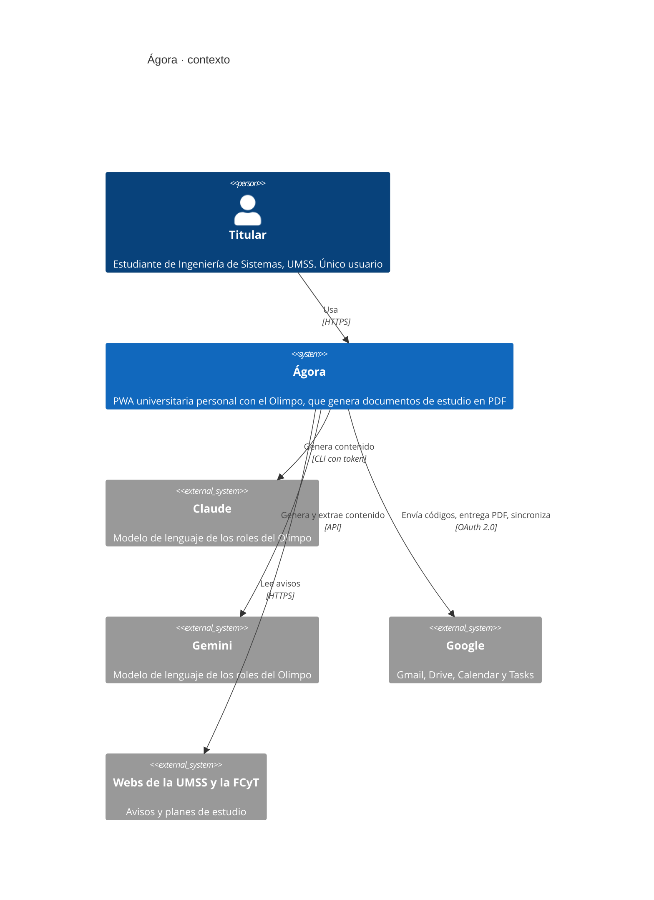
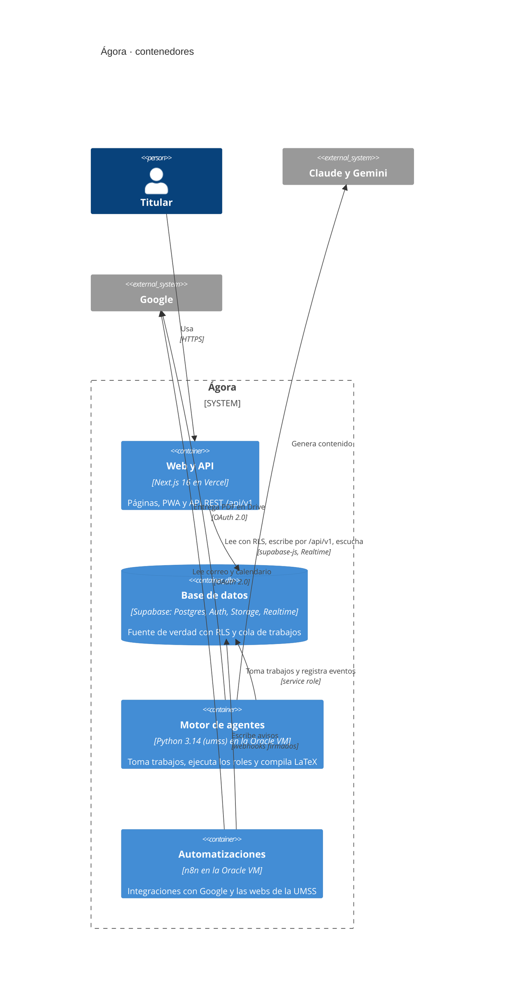

# Arquitectura · Ágora

Versión 3.0 · creado el 2026-10-20 · editado el 2026-11-01 · autor: Juan Diego Pardo Pozo

Decisiones: ADR-001 (stack web), ADR-002 (arquitectura general), ADR-003 (Olimpo), ADR-004 (render en canvas), ADR-005 (dioses y roles), ADR-006 (entorno de desarrollo aislado), ADR-007 (licencia LGPL de sharp-libvips). Rutas y API: `docs/arquitectura/api.md`. Especificación funcional original: `docs/referencia/handoff/CONTEXTO.md` (si hay diferencias, mandan los ADR).

Esta es la descripción de la arquitectura de Ágora. Sigue la estructura de la norma ISO/IEC/IEEE 42010: identifica a las partes interesadas y sus preocupaciones, define los puntos de vista y presenta una vista por cada uno. Las vistas extensas están en archivos aparte (sección 2) y los atributos de calidad siguen el modelo de ISO/IEC 25010 (sección 8).

## 1. Partes interesadas y preocupaciones

| Parte interesada | Preocupaciones principales | Vistas que las responden |
|---|---|---|
| Titular como usuario | Que la plataforma funcione en el celular y en el escritorio, sea accesible, rápida y segura, y que los documentos lleguen completos | Contexto, comportamiento, atributos de calidad |
| Titular como desarrollador | Dónde va cada cosa, qué puede depender de qué, cómo se prueba y cómo se despliega | Contenedores, componentes, despliegue y proceso |
| Docentes de las materias | Trazabilidad entre historias, criterios de aceptación, pruebas y defectos; uso de estándares | Esta sección, la sección 10 y `docs/qa/` |
| Proveedores (Vercel, Supabase, Oracle, Google, Anthropic) | Uso dentro de los niveles gratuitos y de sus condiciones | Despliegue, datos (consumo) |

## 2. Puntos de vista y vistas

| Punto de vista | Pregunta que responde | Modelos | Vista |
|---|---|---|---|
| Contexto | ¿Quién usa el sistema y con qué sistemas externos se comunica? | C4, nivel 1 | Sección 3.1 |
| Contenedores | ¿Qué piezas se despliegan por separado y cómo se comunican? | C4, nivel 2 | Sección 3.2 |
| Componentes | ¿Cómo se organiza el código por dentro y qué puede depender de qué? | C4, nivel 3; diagramas de dependencias | [`componentes.md`](componentes.md) |
| Información | ¿Qué datos guarda, cómo se relacionan y quién puede leerlos? | Entidad-relación por dominio; políticas RLS | [`datos.md`](datos.md) |
| Comportamiento | ¿Cómo ocurren los flujos principales y cómo cambia el estado de cada entidad? | Diagramas de secuencia; máquinas de estados | [`comportamiento.md`](comportamiento.md) |
| Despliegue y proceso | ¿Dónde corre cada pieza y cómo llega un cambio a producción? | C4 de despliegue; diagramas de flujo | [`despliegue.md`](despliegue.md) |
| Interfaz de programación | ¿Qué rutas expone la API y con qué contrato? | Inventario de rutas; OpenAPI generado desde Zod | [`api.md`](api.md) |
| Decisiones | ¿Por qué el sistema es así y qué alternativas se descartaron? | Registros de decisiones (ADR) | [`adr/`](adr/ADR-001-stack-web-nextjs.md) |

Todos los diagramas se escriben en Mermaid dentro del Markdown, así que GitHub los dibuja sin herramientas adicionales y se revisan en el mismo PR que el código. Cada vista indica de qué archivos o ADR sale; la sección 11 dice cuándo se actualiza.

## 3. Vista general

```
Navegador (PWA Next.js)
   │  lecturas con RLS · Realtime · escrituras por /api/v1
   ▼
Vercel ── Next.js 16: páginas (Server/Client Components) + API REST /api/v1
   │  @supabase/ssr (sesión del usuario) · service role solo en src/server
   ▼
Supabase ── Postgres (+pgvector, RLS) · Auth · Storage · Realtime · cola de trabajos
   ▲                              ▲
   │ service role                 │ service role
Oracle VM (ARM, Ubuntu)           n8n (misma VM)
 ├─ motor de agentes `umss` (systemd, hexagonal, roles como plugins)
 ├─ router de modelos Claude/Gemini · TeX Live · Chromium
 └─ métricas → metricas_vm        └─ Gmail, webs UMSS/FCyT, Calendar, Tasks → webhooks firmados
        └─► Google Drive (entregas por materia)
```

### 3.1. Contexto (modelo C4, nivel 1)

Quién usa Ágora y con qué sistemas externos se comunica. Los diagramas siguen el modelo C4 de Simon Brown y se escriben en Mermaid, que GitHub dibuja sin herramientas adicionales.



### 3.2. Contenedores (modelo C4, nivel 2)

Las piezas que se despliegan por separado y cómo se comunican. La web y el motor de agentes nunca se llaman entre sí: se coordinan por la cola de trabajos en Postgres y por Realtime.



## 4. Estilo arquitectónico de cada pieza

| Pieza | Arquitectura | Detalle |
|---|---|---|
| Web (Vercel) | **Monolito modular por dominio** | `src/features/<dominio>/{ui,application,domain,infra}` con API pública en `index.ts` (ADR-002) |
| API (Vercel, dentro de Next) | **REST versionada** `/api/v1` | Handlers delgados: validar (Zod) → autorizar → caso de uso → respuesta (`docs/arquitectura/api.md`) |
| Datos (Supabase) | Postgres como fuente de verdad, con RLS | Migraciones versionadas; nunca se edita una migración aplicada |
| Motor de agentes (VM) | **Hexagonal** + registro de roles | Puertos `Cola`, `ModeloLLM`, `Almacen`, `Compilador`, `Notificador`, `RegistroEventos` |
| n8n (VM) | Flujos de integración | Solo como pegamento; escribe en Supabase o llama a webhooks firmados |

En conjunto, Ágora es un **monorepo** con un **monolito modular** (la web y su API) y un **motor de agentes asíncrono** que se comunica con ella por una cola de trabajos en Postgres. No usa microservicios: para un solo usuario agregarían despliegues y fallas de red sin ningún beneficio.

La arquitectura hexagonal se aplica **solo al motor de agentes**, que corre en la VM. El servidor web no la usa.

## 5. Estructura del monorepo

```
apps/web/                         Next.js 16
  src/
    app/
      (auth)/login/               página pública
      (app)/                      layout con sidebar y barra inferior; requiere sesión
        page.tsx                  Inicio
        olimpo/  tareas/  agenda/  materias/  estudiar/  avisos/  configuracion/
      api/v1/<recurso>/route.ts   API REST (docs/arquitectura/api.md)
      globals.css                 tokens (docs/diseno/sistema-de-diseno.md, sección 2)
    features/<dominio>/           olimpo, encargos, consumo, materias, malla, agenda, tareas, avisos, estudio, inicio, cuenta
    components/ui/                kit shadcn/ui adaptado al diseño
    shared/                       config (navegación), lib, tipos generados (database.types.ts)
    server/                       clientes de servidor (service role), correo, firmas, errores HTTP
    proxy.ts                      sesión + dispositivo verificado (en Next 16, «middleware» se llama «proxy»)
  tests/  e2e/ (Playwright y axe)  api/ (Bruno)
                                  las pruebas unitarias van junto al código que prueban (*.test.ts, *.test.tsx)
apps/worker/                      motor de agentes (Python 3.14 + uv; fuera del workspace de pnpm)
  umss/dominio/  umss/puertos/  umss/adaptadores/  umss/roles/  tests/
supabase/  config.toml  migrations/  tests/ (pgTAP)  borradores/ (esquema inicial y semilla hasta T-03)
infra/     local/ (compose de n8n y del worker)  n8n/ (flujos exportados en JSON, sin credenciales)  vm/ (systemd, scripts y respaldos de la Oracle VM, T-07)
scripts/   utilidades (diseño, verificación de docs)
docs/      índice en docs/README.md: producto, qa, arquitectura (api, adr), diseno, guias, plantillas, referencia
design/    pantallas (.dc.html), mockups (PNG), referencias, fuente (export local, no versionado)
.github/   workflows de CI/CD, plantillas de PR e issues, CONTRIBUTING.md y SECURITY.md
.mise/tasks/  tareas del entorno local (mise run arriba, abajo, estado, entorno:env, n8n:clave)
```

## 6. Flujo de un encargo

1. La web llama a `POST /api/v1/encargos`. El caso de uso valida y crea `trabajos` (`en_cola`).
2. El motor de agentes ejecuta `tomar_trabajo('vm-oracle-1')` (`FOR UPDATE SKIP LOCKED`).
3. Para cada paso de `pipeline_pasos` resuelve el **rol** y el **dios** titular (ADR-005), escribe `trabajo_pasos` y emite `eventos_agente` (`dios_id`, `rol_id`).
4. Si `aprobar_esquema` está activo, inserta en `esquemas` (`pendiente`) y espera `POST /api/v1/esquemas/{id}/decision`.
5. Entrega el PDF en Storage (`documentos/`) y en Drive, y registra `documentos`.
6. La web recibe todo por Realtime; la Oficina del Olimpo anima a los dioses.

El diagrama de secuencia completo y las máquinas de estados del trabajo, de sus pasos y de los dioses están en [`comportamiento.md`](comportamiento.md).

## 7. Seguridad

- Supabase Auth (correo + contraseña) por debajo; en la interfaz se entra con **usuario**. `POST /api/v1/auth/sesion` resuelve usuario → correo en el servidor y nunca expone el correo.
- 2FA por Gmail en dispositivos nuevos: código de 6 dígitos guardado como hash (10 min, 5 intentos), cookie firmada `agora_device` y el proxy de Next (`src/proxy.ts`) que bloquea `(app)` hasta verificar.
- Política de contraseña en cliente, servidor y Supabase Auth.
- RLS en todas las tablas. Bucket `documentos` privado con URLs firmadas de 5 minutos. Registro público desactivado.
- Escrituras: verificación de origen (`Origin`), cookies `SameSite=Lax`, límites de frecuencia en autenticación y webhooks firmados con HMAC.

## 8. Atributos de calidad (ISO/IEC 25010)

Las características de calidad siguen la edición 2023 de ISO/IEC 25010. Cada una tiene un objetivo medible, el mecanismo de la arquitectura que lo cumple y la prueba que lo verifica. Los CA-NF de las HU usan estas mismas características.

| Característica | Objetivo | Mecanismo | Verificación |
|---|---|---|---|
| Adecuación funcional | Cada HU cumple sus criterios de aceptación | Casos de uso en `application/`; reglas en `domain/` | Test cases (`docs/qa/test-cases/`), Vitest y Playwright |
| Eficiencia de desempeño | Lighthouse de 0,9 o más en móvil; LCP de 2,5 s o menos; CLS de 0,1 o menos (HU-16.04) | Server Components, caché de TanStack Query, Vercel y Supabase en la misma región | Lighthouse CI en cada PR que cambia la web |
| Compatibilidad | Funciona en Chromium, Firefox y Safari; la imagen del motor corre en amd64 y arm64 | PWA estándar; imágenes multiplataforma | E2E en tres navegadores; job «Imagen del worker» en dos arquitecturas |
| Capacidad de interacción (antes usabilidad) | WCAG 2.2 AA en todas las pantallas, tema claro y oscuro, escritorio y móvil | Kit de interfaz accesible (Radix), tokens de contraste (`docs/diseno/accesibilidad.md`) | axe en cada ruta de `tests/e2e/rutas.ts` sin violaciones *serious* ni *critical* |
| Fiabilidad | Ningún encargo se pierde si la VM cae; un trabajo se retoma desde el último paso hecho | Cola en Postgres con `FOR UPDATE SKIP LOCKED`; comunicación solo por la base de datos | Pruebas del motor (pytest) y de la base (pgTAP) |
| Seguridad | Solo el titular accede a sus datos; ningún secreto llega al navegador ni al repositorio | RLS en todas las tablas, 2FA por correo, service role solo en el servidor, webhooks con HMAC | pgTAP de RLS, gitleaks, CodeQL, revisión de seguridad en los PR de EP-03, EP-04, EP-07 y EP-13 |
| Mantenibilidad | Un dominio se cambia sin tocar los demás; un rol nuevo no toca el núcleo | Monolito modular con límites verificados; motor hexagonal con roles como *plugins* | ESLint boundaries, Knip, cobertura de 80 % en `src/server` y `src/features` |
| Flexibilidad (antes portabilidad) | El entorno se reproduce en otro equipo con una sola orden | mise fija las versiones; servicios en contenedores (ADR-006) | Clon limpio y `scripts/verificar-entorno.sh` |
| Protección | No aplica: Ágora no controla equipos ni procesos con riesgo físico | — | — |

## 9. Entornos

| Entorno | Rama | Web | Datos |
|---|---|---|---|
| Local | cualquiera | `pnpm dev` (nativo, puerto 3100) | Supabase CLI + Docker (puertos 55320 a 55329); n8n y worker en Docker |
| Preview | PR hacia `develop` o `main` | Vercel (preview por PR) | Proyecto Supabase de desarrollo |
| Staging | `develop` | Vercel (alias de staging) | Proyecto Supabase de desarrollo |
| Producción | `main` (con etiqueta de versión) | Vercel producción | Proyecto Supabase de producción (con aprobación manual) |

El entorno local está aislado del resto del equipo (ADR-006): mise fija las versiones de Node, pnpm, Python, uv y la CLI de Supabase solo dentro de la carpeta del proyecto, y los servicios corren en contenedores descartables con un bloque de puertos propio. La preparación paso a paso está en `docs/guias/entorno/`.

El flujo de ramas, los commits y el pipeline están en `.github/CONTRIBUTING.md` y `.github/workflows/`. Los diagramas de despliegue, del entorno local y del camino de un cambio hasta producción están en [`despliegue.md`](despliegue.md).

## 10. Normas y modelos de referencia

| Norma o modelo | Qué toma Ágora | Dónde se aplica |
|---|---|---|
| ISO/IEC/IEEE 42010:2022, descripción de la arquitectura | Partes interesadas, preocupaciones, puntos de vista y vistas | Este documento y sus vistas |
| ISO/IEC 25010:2023, modelo de calidad del producto | Características de calidad con objetivos medibles | Sección 8 y los CA-NF de las HU |
| ISO/IEC/IEEE 29148:2018, ingeniería de requisitos | Requisitos verificables, trazables y sin ambigüedad | Ficha de HU (`docs/plantillas/HU.md`) y matriz de trazabilidad |
| ISO/IEC/IEEE 29119-3:2021, documentación de pruebas | Plan, casos y reportes de incidentes | `docs/qa/plan-pruebas.md`, sección 8 |
| Modelo C4 (Simon Brown) | Contexto, contenedores, componentes y despliegue | Secciones 3.1 y 3.2, `componentes.md` y `despliegue.md` |
| Registros de decisiones (Michael Nygard) | Una decisión por documento, que no se borra | `docs/arquitectura/adr/` |

Las normas se usan como guía de estructura y de contenido; Ágora no persigue una certificación.

## 11. Mantenimiento de los diagramas

Un diagrama que contradice el código es peor que no tenerlo. Por eso:

- Cada vista indica sus fuentes, y quien cambia una fuente actualiza la vista en el mismo PR. La plantilla de PR lo incluye en su lista de verificación.
- La vista de datos se basa en el esquema borrador hasta T-03; desde entonces, su fuente son las migraciones de `supabase/migrations/`.
- Los diagramas se escriben en Mermaid y no como imágenes, para que los cambios se revisen como texto.
