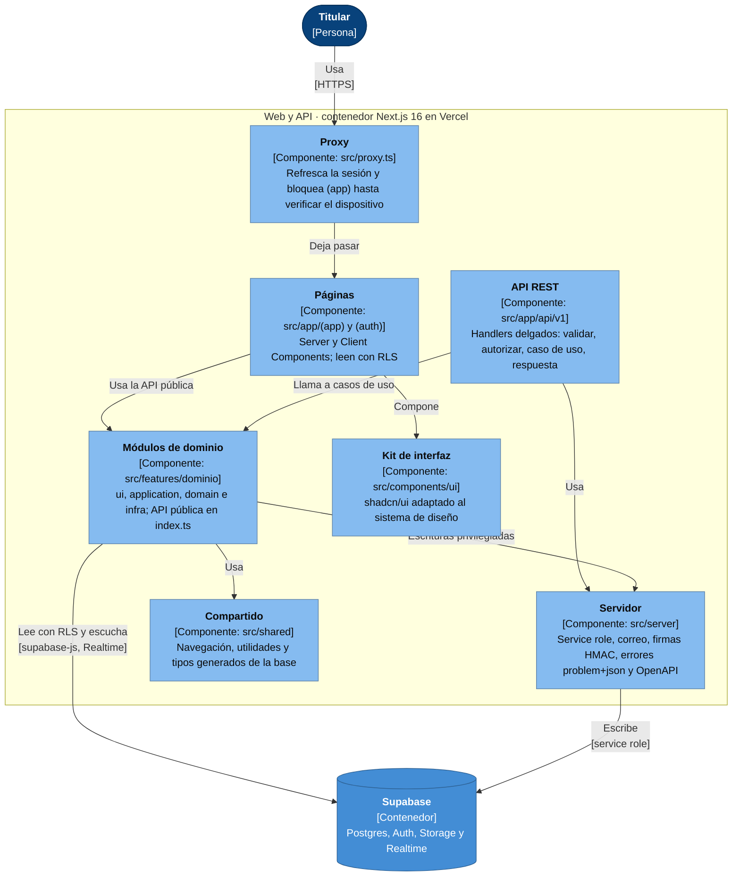
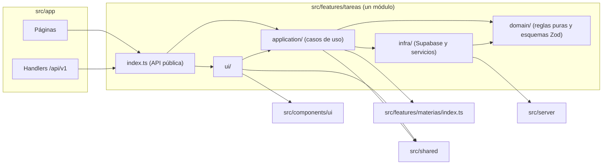
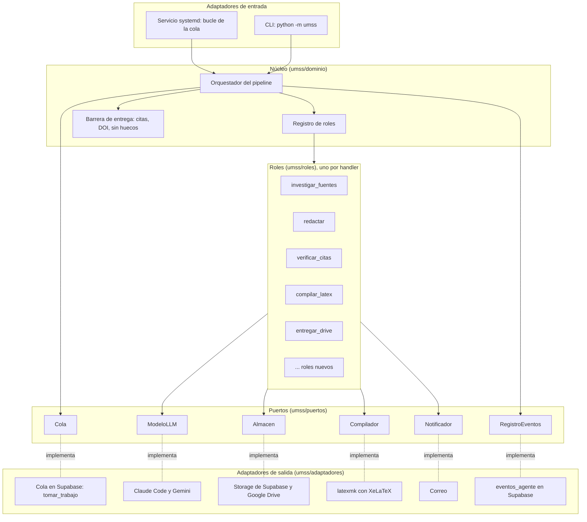

# Vista de componentes · Ágora

Versión 1.1 · creado el 2026-11-01 · editado el 2026-11-01 · autor: Juan Diego Pardo Pozo

Estructura interna de los dos contenedores con código propio: la web (con su API) y el motor de agentes. Es el nivel 3 del modelo C4 y la vista de módulos de la descripción de arquitectura (`docs/arquitectura/README.md`, sección 2).

**Fuentes:** ADR-002 (monolito modular y motor hexagonal) y ADR-005 (dioses y roles). Las reglas de dependencia de la web las hace cumplir ESLint (`eslint-plugin-boundaries`) en el CI; las del motor, la revisión de cada PR. Si un ADR cambia la estructura, actualiza este documento en el mismo PR.

## 1. Web y API (Next.js)

La web es un **monolito modular por dominio**: cada dominio vive en `src/features/<dominio>/` y solo expone su `index.ts`. Las páginas y los handlers de la API son delgados: delegan en los casos de uso del dominio.

### 1.1. Dependencias permitidas

Dentro de un módulo de dominio, las capas solo dependen hacia adentro: la interfaz usa los casos de uso, los casos de uso usan el dominio y la infraestructura, y el dominio no depende de nadie.

| Regla | Qué impide |
|---|---|
| Un módulo solo importa el `index.ts` de otro módulo | Que un cambio interno de `materias` rompa `tareas` |
| `domain/` no importa React, Next ni Supabase | Reglas de negocio atadas a un framework; así se prueban con Vitest sin nada más |
| La lógica de negocio vive en `domain/` y `application/` | Reglas escondidas en componentes o en `route.ts` |
| La service role solo existe en `src/server/` | Que una clave con acceso total llegue al navegador |
| Toda escritura con reglas de negocio pasa por `/api/v1` | Escrituras sin validación ni contrato |

### 1.2. Módulos de dominio previstos

| Módulo | Épicas | Recurso de la API |
|---|---|---|
| `cuenta` | EP-03, EP-04 | `/auth`, `/perfil`, `/dispositivos`, `/integraciones` |
| `olimpo` | EP-05 | `/dioses`, `/roles` |
| `encargos` | EP-06 | `/encargos`, `/esquemas`, `/documentos` |
| `consumo` | EP-08 | `/consumo` |
| `materias` | EP-09 | `/materias` |
| `malla` | EP-10 | `/malla` |
| `agenda` | EP-11 | `/eventos` |
| `tareas` | EP-12 | `/tareas`, `/listas` |
| `avisos` | EP-13 | `/avisos`, `/reglas-avisos`, `/webhooks/n8n` |
| `estudio` | EP-14 | `/mazos`, `/tarjetas`, `/sesiones` |
| `inicio` | EP-15 | Solo lectura |

El inventario exacto de rutas está en `docs/arquitectura/api.md`.

## 2. Motor de agentes (`umss`, Python)

El motor sigue la **arquitectura hexagonal**: el núcleo (dominio y orquestador) define puertos, y los adaptadores los implementan con la tecnología del momento. Cambiar de modelo, de cola o de almacenamiento es cambiar un adaptador, no el núcleo. Los **roles** son *plugins*: cada uno es un *handler* registrado por nombre con `@registrar_rol("nombre")` (ADR-005).

| Regla | Qué impide |
|---|---|
| El núcleo y los roles solo conocen puertos | Que cambiar de modelo o de cola obligue a reescribir el pipeline |
| Un rol nuevo es un *handler* más y una fila en `roles` | Tocar el orquestador para crecer |
| El pipeline resuelve qué dios ejecuta cada rol en tiempo de ejecución | Atar un rol a un dios concreto |
| Las verificaciones de la barrera de entrega no se desactivan | Entregar un PDF con citas inventadas o secciones vacías |
| El motor solo se comunica con la web por la base de datos | Que una caída de la VM rompa la web |
