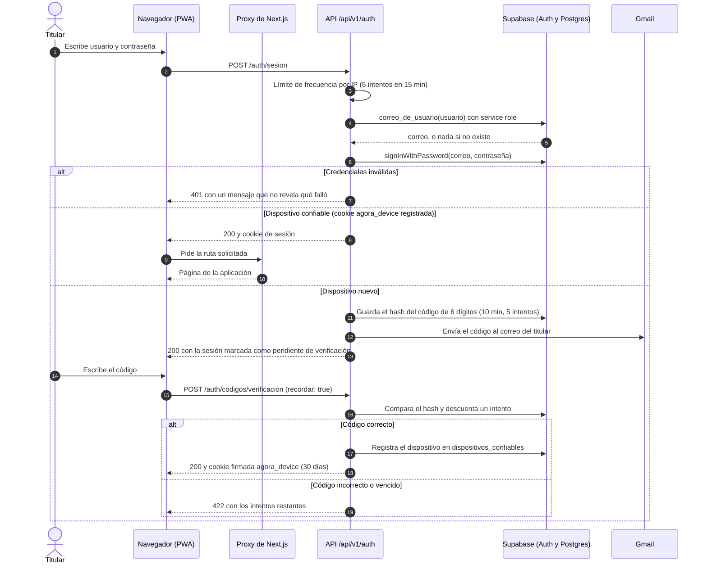
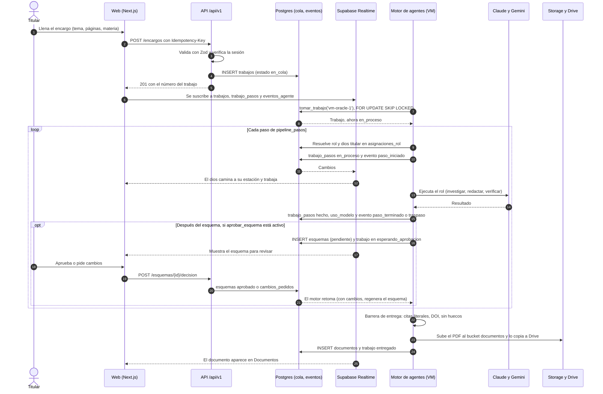
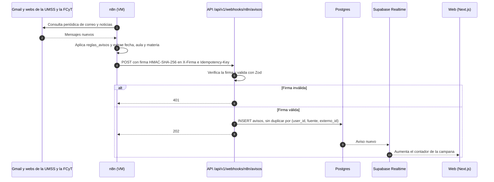
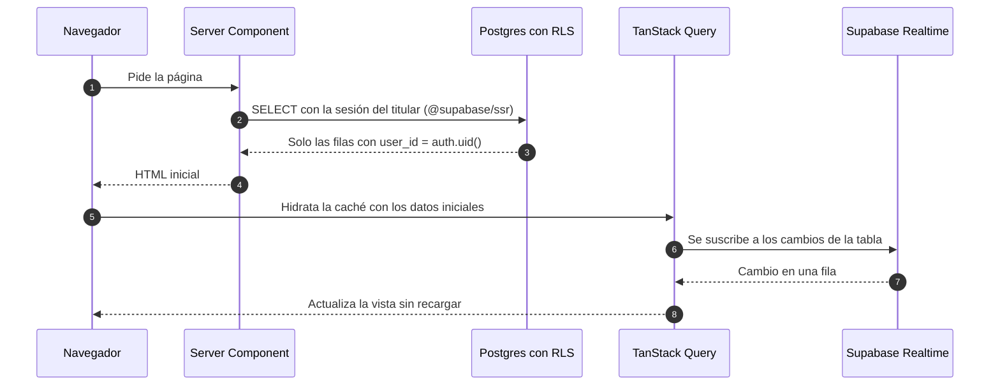
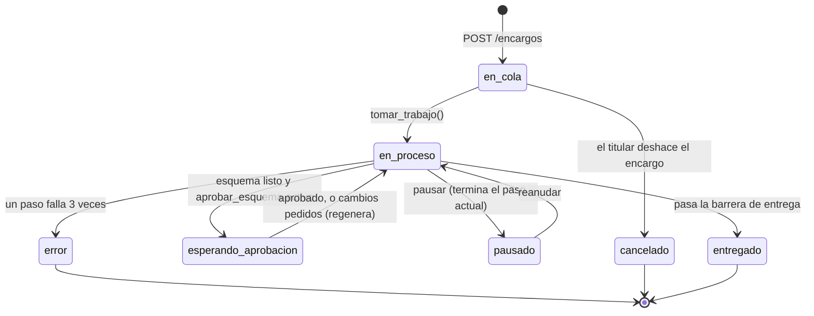
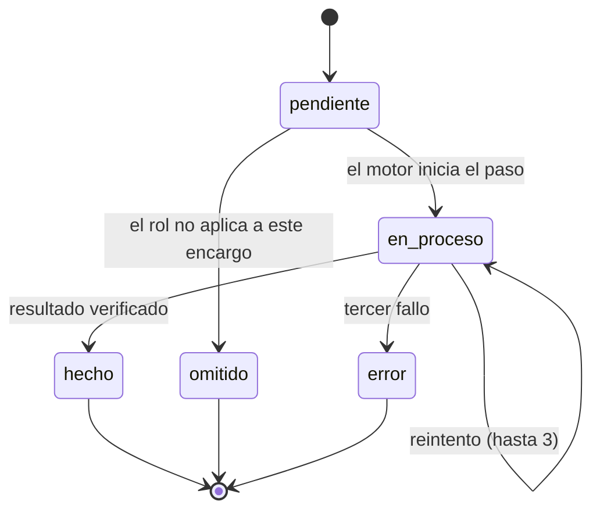
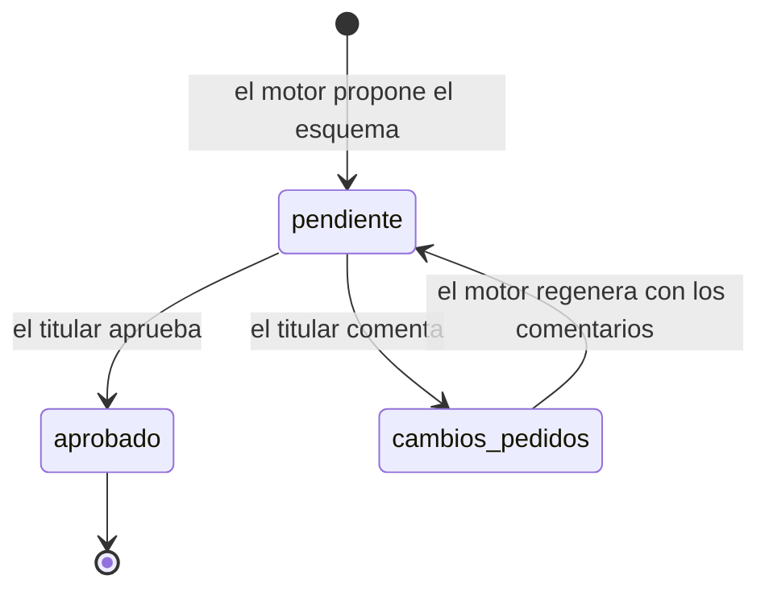
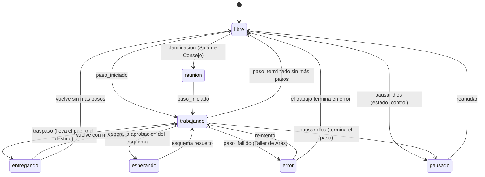
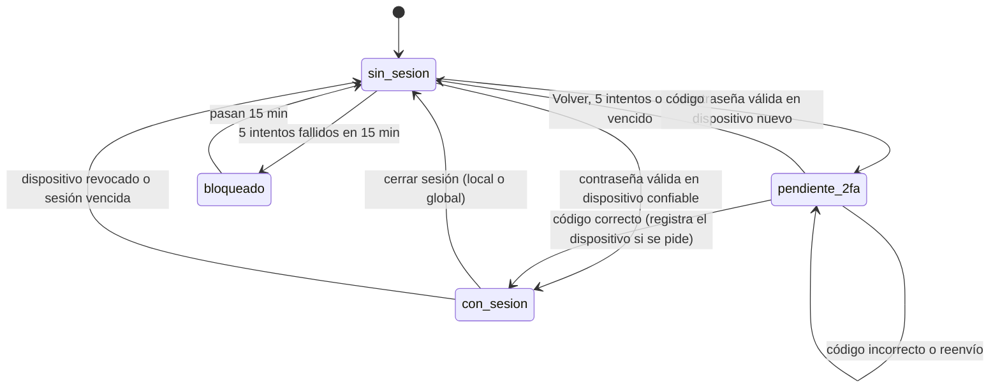
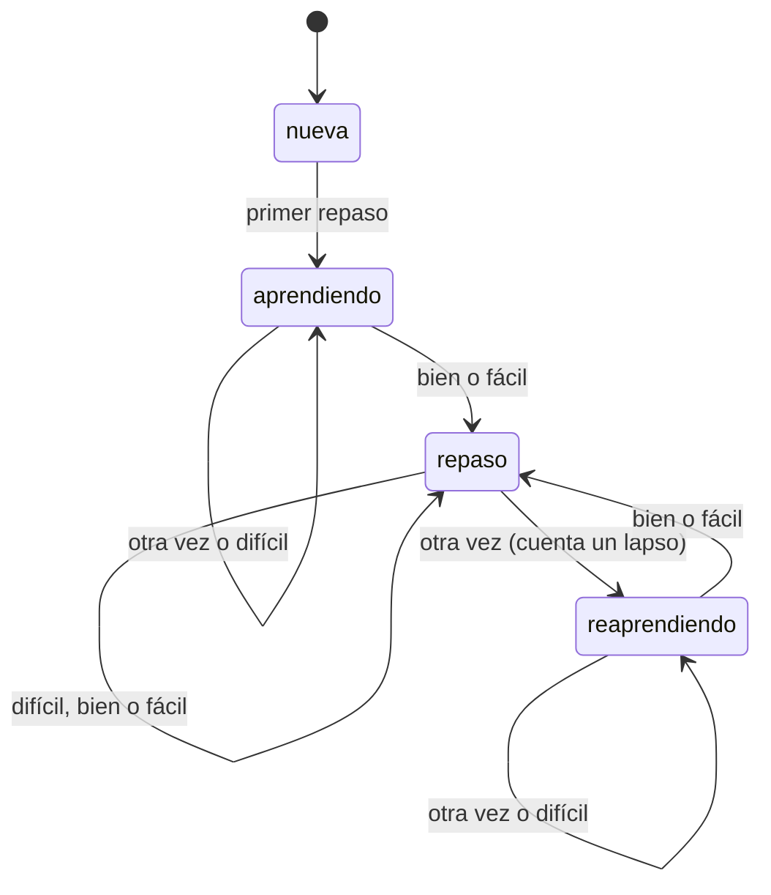

# Vista de comportamiento · Ágora

Versión 1.0 · creado el 2026-11-01 · editado el 2026-11-01 · autor: Juan Diego Pardo Pozo

Cómo se comporta Ágora en el tiempo: los flujos principales, en diagramas de secuencia, y el ciclo de vida de sus entidades, en máquinas de estados. Es la vista de comportamiento de la descripción de arquitectura (`docs/arquitectura/README.md`, sección 2).

**Fuentes:** `docs/arquitectura/api.md` (rutas), `docs/arquitectura/datos.md` (tablas y enums), ADR-002 (comunicación por la base de datos), ADR-005 (dioses y roles) y las reglas de negocio de las HU citadas en cada diagrama. Si una HU cambia un flujo o un estado, actualiza este documento en el mismo PR.

## 1. Flujos principales (diagramas de secuencia)

### 1.1. Inicio de sesión con verificación del dispositivo (HU-03.01, HU-03.02)

El navegador nunca conoce el correo: el servidor resuelve el usuario con la service role. En un dispositivo nuevo, la sesión queda pendiente hasta verificar el código enviado por Gmail.

### 1.2. Encargo de un documento de punta a punta (EP-06, EP-07)

La web y el motor de agentes nunca se llaman entre sí (ADR-002): se coordinan por la cola de trabajos en Postgres y por Realtime. Si la VM está apagada, el encargo espera en la cola.

### 1.3. Llegada de un aviso desde n8n (EP-13)

n8n solo hace de pegamento: lee las fuentes y entrega los avisos a la API por un webhook firmado. La API valida la firma, evita duplicados y guarda el aviso.

### 1.4. Lectura de datos desde una pantalla (ADR-002)

Las lecturas no pasan por la API: van directo a Supabase con la sesión del titular, y RLS filtra las filas. Solo las escrituras con reglas de negocio pasan por `/api/v1`.

## 2. Ciclos de vida (máquinas de estados)

### 2.1. Trabajo (`trabajos.estado`, HU-06.01, HU-06.06, HU-07.01)

- Si el motor se reinicia en mitad de un trabajo, lo retoma desde el último paso `hecho` sin cambiar de estado (HU-07.01, RN-5).
- La cola es FIFO: un trabajo pausado no deja pasar al siguiente, salvo que el titular elija «Atender el siguiente» (HU-06.06, RN-3).
- Regla «entrega completa a la primera»: no hay transición a `entregado` con huecos o cajas «Pendiente».

### 2.2. Paso de un trabajo (`trabajo_pasos.estado`)

### 2.3. Esquema (`esquemas.estado`, HU-06.04)

### 2.4. Dios en la Oficina del Olimpo (`dioses.estado`, HU-05.02, HU-05.05)

Los dioses nunca están inmóviles: cada estado tiene una animación continua (`docs/diseno/sistema-de-diseno.md`, sección 8.4). Los eventos de `eventos_agente` provocan las transiciones y se procesan en orden por dios.

### 2.5. Sesión y dispositivo (HU-03.01 a HU-03.05)

### 2.6. Tarjeta de repaso (`tarjetas.state`, FSRS, EP-14)

Los estados son los del algoritmo FSRS; las transiciones dependen de la calificación del repaso (1 otra vez, 2 difícil, 3 bien, 4 fácil).

