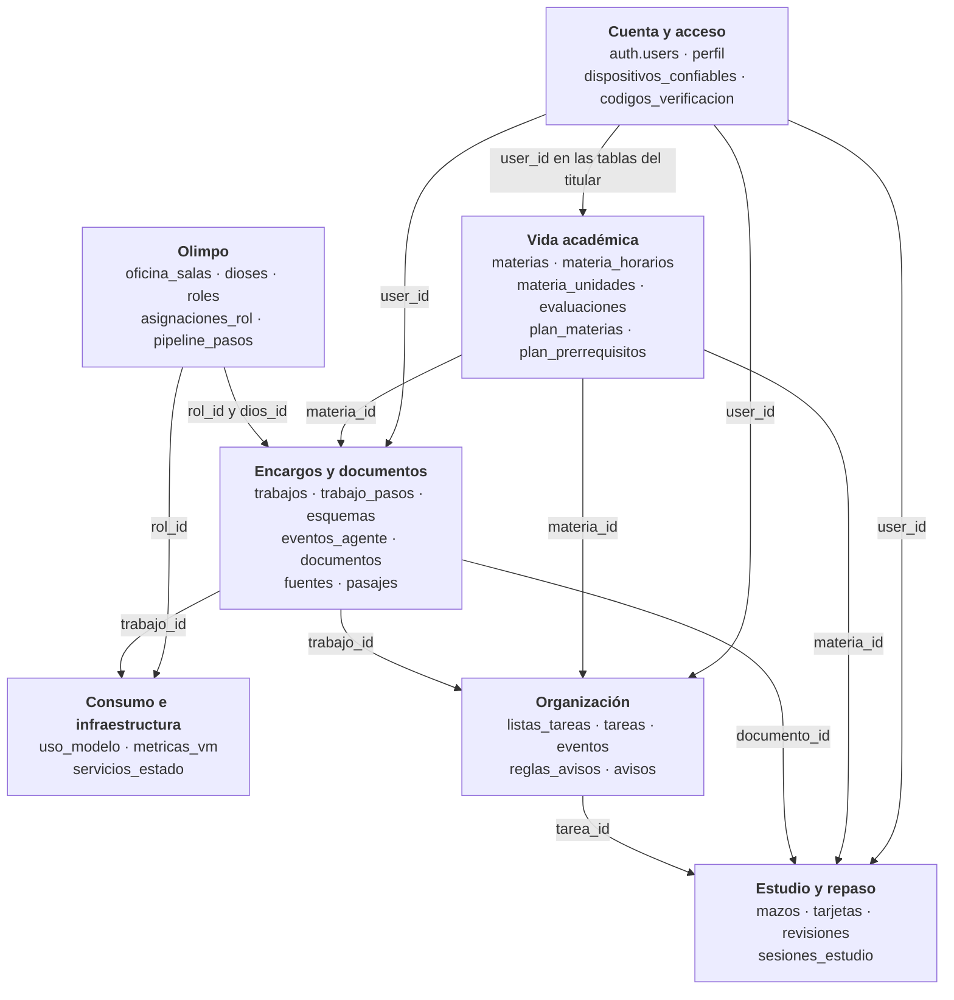
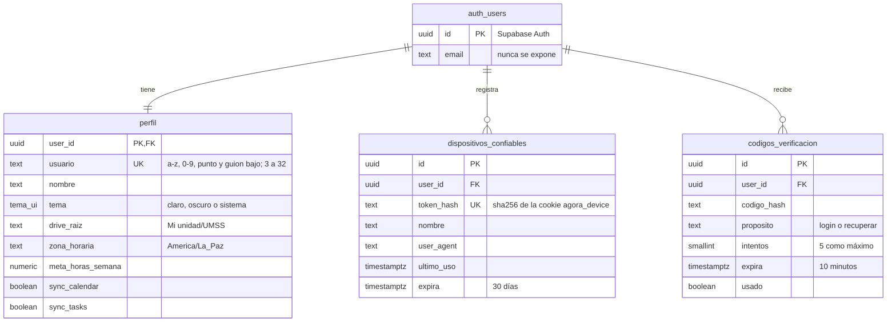
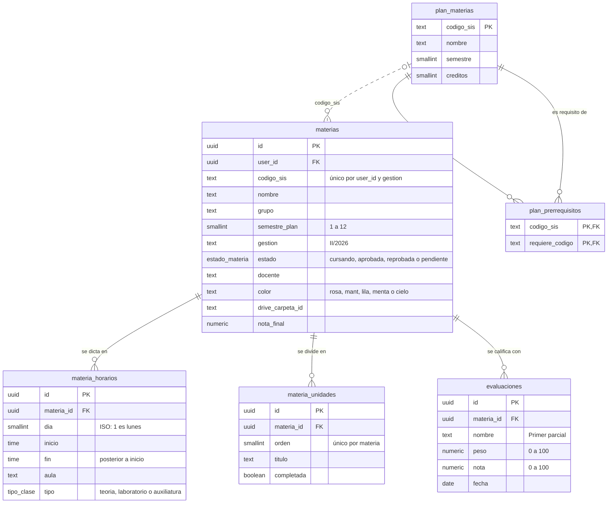
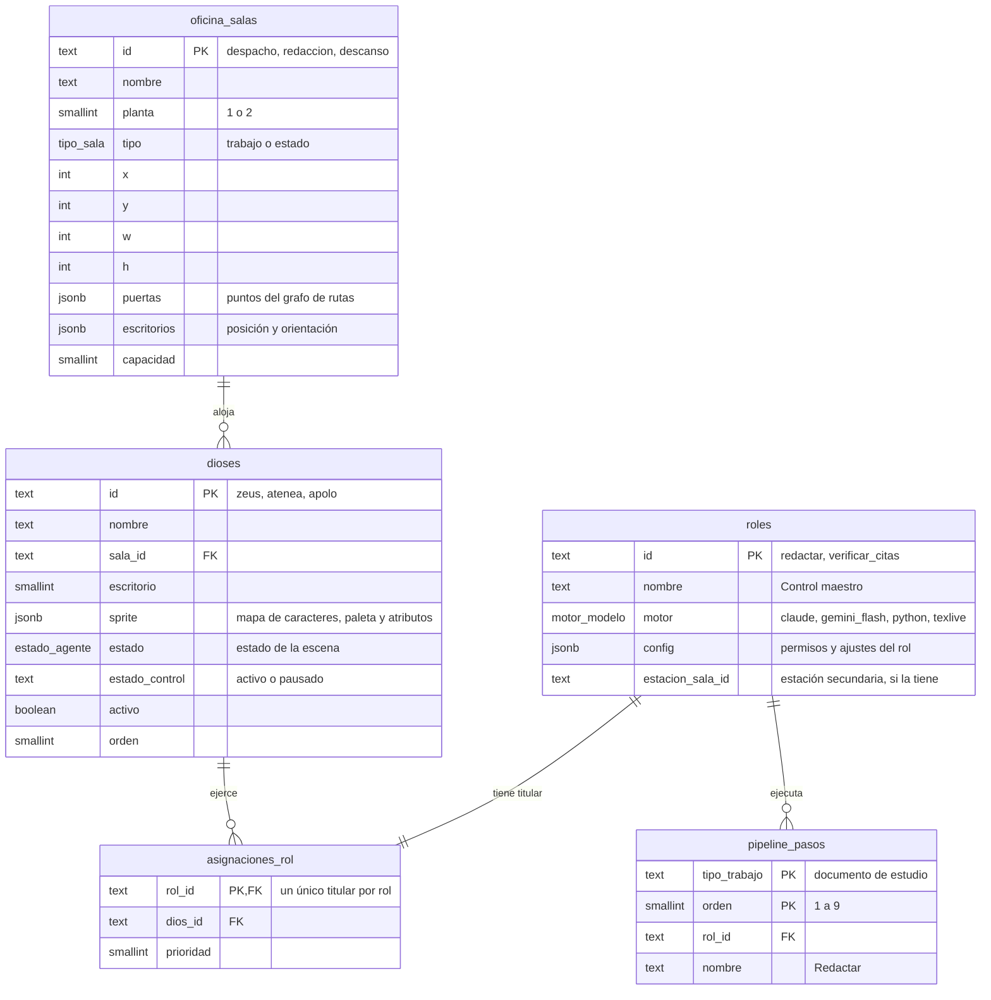
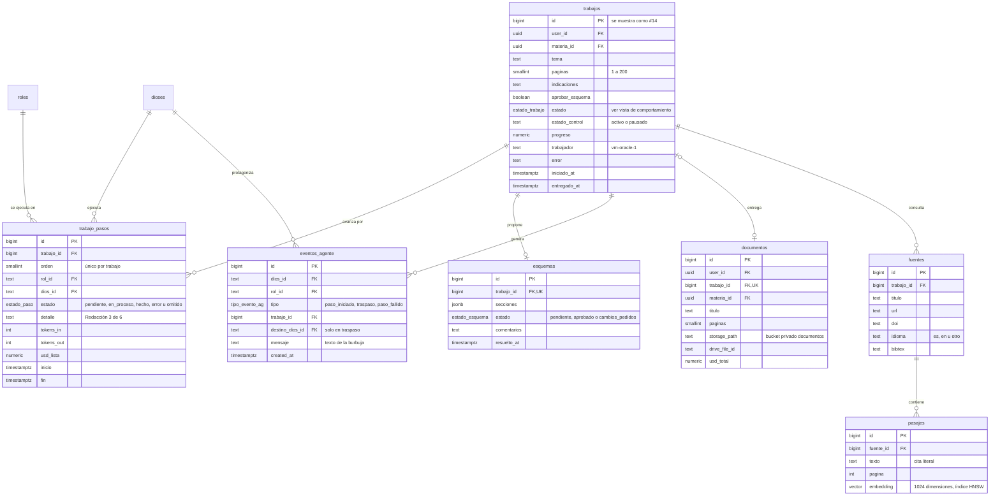
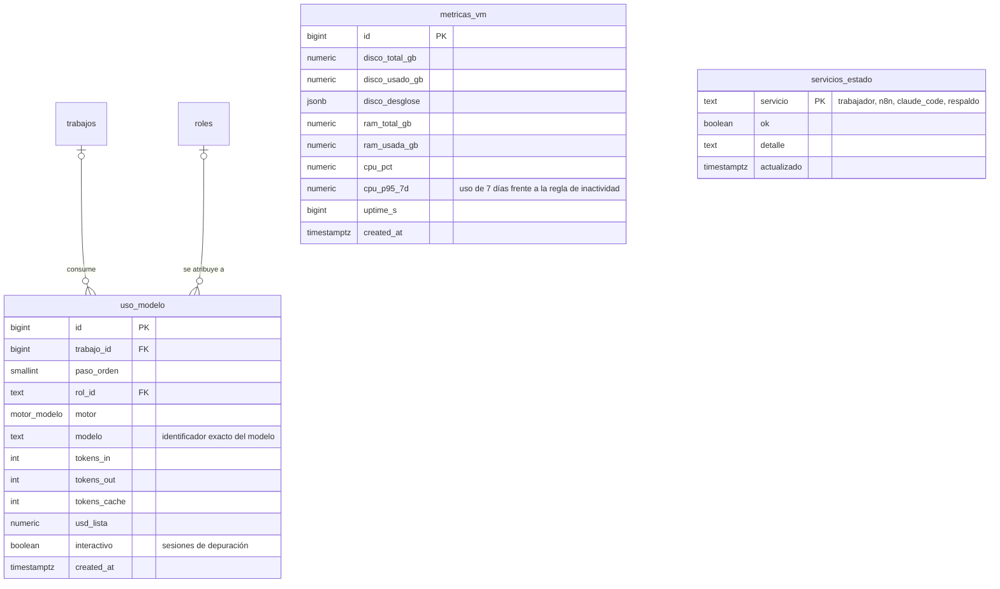
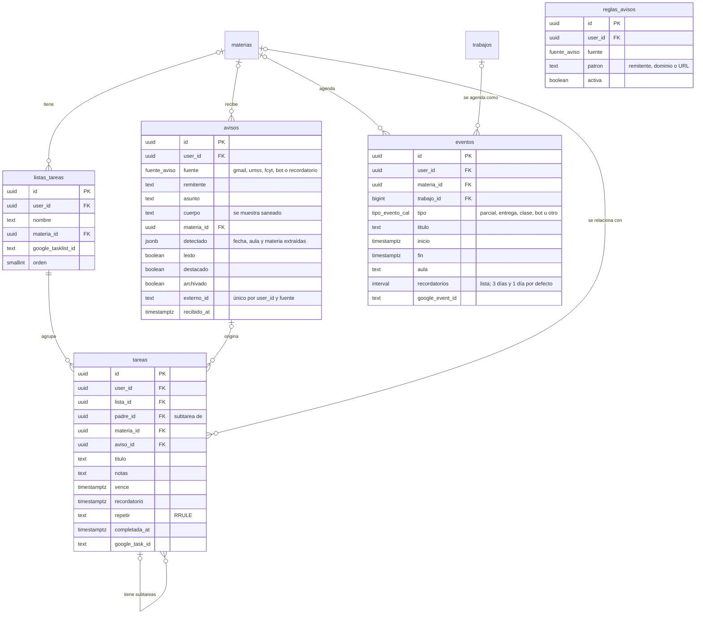
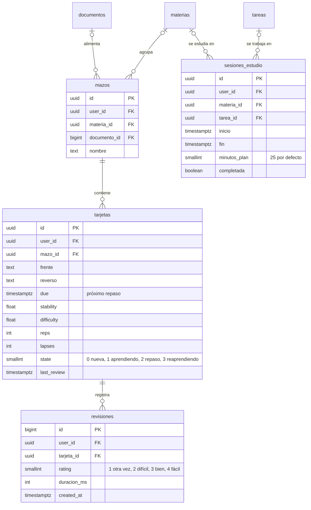

# Vista de datos · Ágora

Versión 1.1 · creado el 2026-11-01 · editado el 2026-11-01 · autor: Juan Diego Pardo Pozo

Modelo de datos de Ágora en diagramas entidad-relación, agrupados por dominio. Es la vista de información de la descripción de arquitectura (`docs/arquitectura/README.md`, sección 2).

## 1. Fuente y estado

- **Fuente:** el esquema borrador `supabase/borradores/0001_init.sql`, corregido con las decisiones de los ADR (ante una diferencia, manda el ADR). El cambio más grande es el de ADR-005: la tabla `agentes` del borrador se reemplaza por `dioses`, `roles`, `asignaciones_rol` y `pipeline_pasos`.
- **Estado:** diseño. El esquema real nace en T-03, al dividir el borrador en migraciones de `supabase/migrations/`. **T-03 actualiza este documento en el mismo PR que crea las migraciones**, y desde entonces la fuente de verdad son las migraciones.
- **Convenciones:** tablas en plural y en español, en `snake_case`. Las claves primarias son `uuid` (datos del usuario) o `bigint` de identidad (registros de alto volumen, como trabajos y eventos). Las fechas son `timestamptz` y se muestran en `America/La_Paz`.
- **Notación de los diagramas:** Mermaid `erDiagram` con la notación pata de gallo. `PK` es clave primaria, `FK` es clave foránea y `UK` es una columna única. Se muestran las columnas que definen el modelo; las de auditoría (`created_at`, `updated_at`) se omiten salvo cuando tienen un significado propio.

## 2. Seguridad del modelo

| Grupo | Tablas | Política RLS |
|---|---|---|
| Datos del titular | Todas las que tienen `user_id` | `propio`: lectura y escritura solo si `user_id = auth.uid()` |
| Catálogos y datos del motor | `plan_materias`, `plan_prerrequisitos`, `oficina_salas`, `dioses`, `roles`, `asignaciones_rol`, `pipeline_pasos`, `trabajo_pasos`, `esquemas`, `eventos_agente`, `fuentes`, `pasajes`, `uso_modelo`, `metricas_vm`, `servicios_estado` | `lectura`: solo lectura para usuarios autenticados. Escribe el worker con la service role |
| Códigos de verificación | `codigos_verificacion` | Sin políticas: solo el servidor la usa, con la service role |

Las funciones `tomar_trabajo` (toma atómica de la cola con `FOR UPDATE SKIP LOCKED`) y `correo_de_usuario` (resuelve usuario a correo sin exponerlo) son `security definer` y solo las ejecuta la service role.

## 3. Mapa general

Los siete dominios del modelo, con sus tablas, y las claves foráneas que los conectan. Las secciones 4 a 10 detallan cada dominio con su diagrama entidad-relación, sus columnas y sus cardinalidades. `auth.users` es la tabla de usuarios de Supabase Auth.

## 4. Cuenta y acceso (EP-03, EP-04)

El usuario entra con su **usuario** (`perfil.usuario`); el correo de Supabase Auth nunca llega al navegador. Un dispositivo nuevo exige un código de 6 dígitos que se guarda como hash, vence a los 10 minutos y admite 5 intentos (HU-03.02).

## 5. Vida académica (EP-09, EP-10)

`materias` son las del titular en cada gestión; `plan_materias` y `plan_prerrequisitos` son el catálogo de la malla curricular, igual para todos, y se relacionan con las materias del titular por `codigo_sis`.

## 6. El Olimpo: dioses y roles (EP-05, ADR-005)

Un **rol** es una capacidad del sistema y un **dios** es la persona visible que lo ejerce. Un rol tiene un solo dios titular y un dios puede tener varios roles. El pipeline de un trabajo apunta a roles, nunca a dioses. La escena (salas, escritorios y sprites) es un dato, así que un dios nuevo aparece sin cambiar código.

La base impide retirar un dios que todavía es titular de algún rol (ADR-005, regla 8): `asignaciones_rol.dios_id` no admite borrar en cascada.

## 7. Encargos, documentos y fuentes (EP-06, EP-07)

Un **trabajo** es un encargo de documento. El worker lo toma de la cola, recorre los pasos de `pipeline_pasos` y registra cada paso en `trabajo_pasos` con el rol y el dios que lo ejecutaron. Si `aprobar_esquema` está activo, el trabajo espera a que el titular apruebe el esquema. Cada acción de un dios queda en `eventos_agente`, que la escena del Olimpo recibe por Realtime.

## 8. Consumo e infraestructura (EP-08)

El panel de consumo compara el uso de los modelos con los límites gratuitos, y el estado de la VM con las reglas de inactividad de Oracle.

## 9. Organización: tareas, agenda y avisos (EP-11, EP-12, EP-13)

Las tareas admiten subtareas y repetición (RRULE, RFC 5545) y pueden nacer de un aviso. Los avisos llegan desde n8n (Gmail y las webs de la UMSS y la FCyT) y no se duplican gracias a `externo_id`.

## 10. Estudio y repaso (EP-14)

Las tarjetas usan el algoritmo FSRS (`ts-fsrs`); sus columnas son las que ese algoritmo necesita para calcular el próximo repaso. Un mazo puede nacer de un documento generado por el Olimpo.

## 11. Diferencias que resuelve T-03

Al comparar el borrador con los ADR y las HU aparecen diferencias. Este documento ya muestra la versión corregida; T-03 debe confirmarlas en las migraciones y en las HU.

| Tema | Borrador `0001_init.sql` | Decisión que manda | Qué se muestra aquí |
|---|---|---|---|
| Agentes | Una tabla `agentes` con `rol` en texto | ADR-005 | `dioses`, `roles`, `asignaciones_rol` y `pipeline_pasos` |
| Pasos y eventos | `trabajo_pasos.agente_id`, `eventos_agente.agente_id` y `uso_modelo.agente_id` | ADR-005, regla 3 | `rol_id` y `dios_id` |
| Pausa de trabajos y dioses | `trabajos.estado = 'pausado'` y `agentes.pausado` | HU-06.06 y HU-05.05 (`estado_control`) | `estado_control` en `trabajos` y `dioses`; T-03 decide si `pausado` sigue en el enum |
| Configuración del rol | `agentes.permisos` | HU-07.01 lee `agentes.config` | `roles.config` |
| Nombre de la fecha de creación | `created_at` | HU-07.01 menciona `creado_en` | `created_at`; T-03 corrige la HU |
| Ruta del inicio de sesión | — | `docs/arquitectura/api.md`: `POST /api/v1/auth/sesion`; HU-03.01 (RN-1) dice `POST /api/auth/login` | La ruta de `api.md`; T-03 o HU-03.01 corrige la HU |
