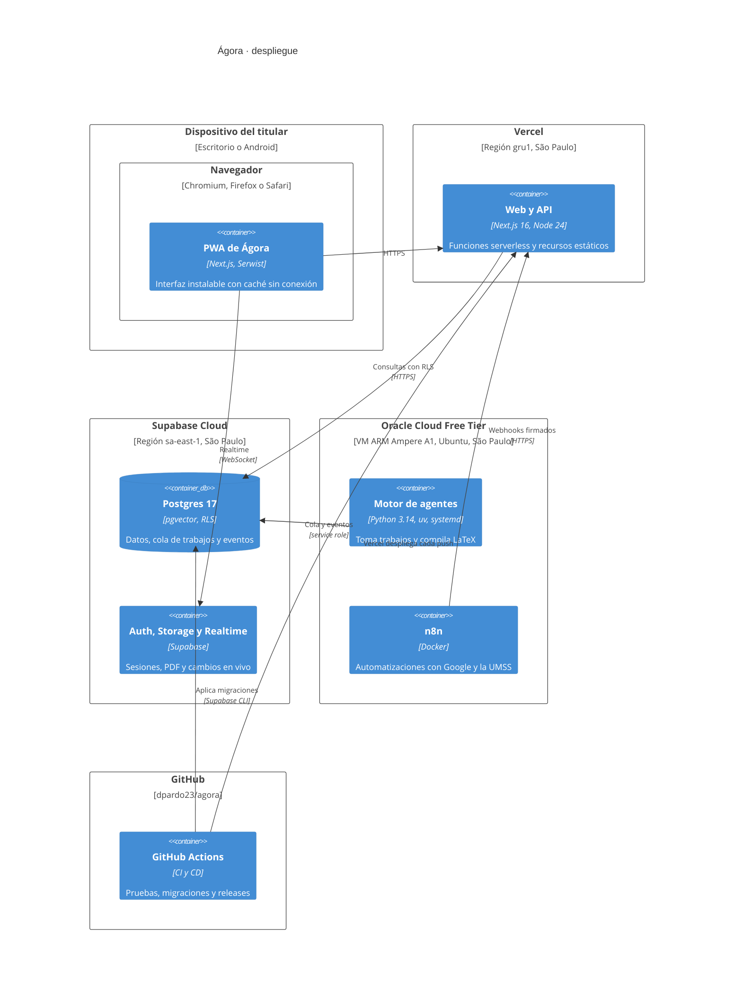
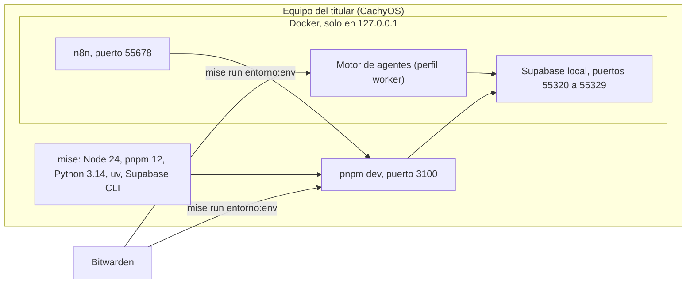
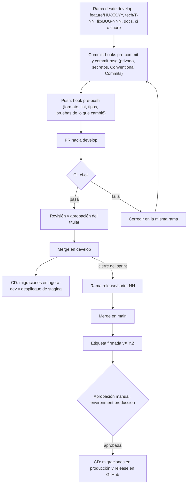
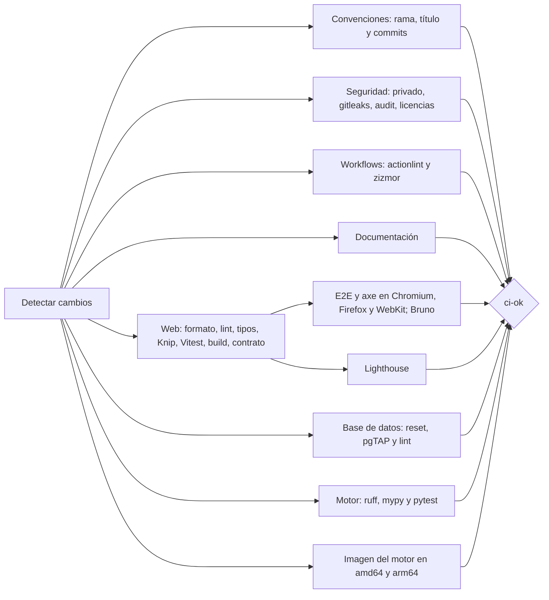

# Vista de despliegue y proceso · Ágora

Versión 1.0 · creado el 2026-11-01 · editado el 2026-11-01 · autor: Juan Diego Pardo Pozo

Dónde corre cada pieza de Ágora y cómo llega un cambio desde una rama hasta producción. Son las vistas de despliegue y de proceso de desarrollo de la descripción de arquitectura (`docs/arquitectura/README.md`, sección 2).

**Fuentes:** ADR-006 (entorno aislado), `.github/CONTRIBUTING.md` (ramas y versiones), `.github/workflows/ci.yml` y `cd.yml`, y las guías de `docs/guias/`. Si cambia la infraestructura o el pipeline, actualiza este documento en el mismo PR.

## 1. Despliegue en la nube (C4, diagrama de despliegue)

Todo corre en la región de São Paulo, la más cercana a Cochabamba, y dentro de los niveles gratuitos de cada proveedor.

| Nodo | Límite gratuito que importa | Cómo se vigila |
|---|---|---|
| Vercel (Hobby) | Uso personal y no comercial | Panel de Vercel |
| Supabase (Free) | 2 proyectos por cuenta; pausa tras 7 días sin actividad | `servicios_estado` y panel de consumo (EP-08) |
| Oracle Cloud (Always Free) | 4 OCPU y 24 GB en ARM; reclama VM con poco uso durante 7 días | `metricas_vm.cpu_p95_7d` y panel de consumo (EP-08) |
| GitHub Actions | Minutos ilimitados en un repositorio público | Pestaña Actions |

## 2. Entornos

| Entorno | Rama o evento | Web | Datos | Motor y n8n |
|---|---|---|---|---|
| Local | Cualquier rama | `pnpm dev`, puerto 3100 | Supabase CLI en Docker, puertos 55320 a 55329 | Docker (`mise run arriba --worker`) |
| Preview | Cada PR | Vercel, una URL por PR | Proyecto `agora-dev` | — |
| Staging | `develop` | Vercel, alias de `develop` | Proyecto `agora-dev` | — |
| Producción | Etiqueta `vX.Y.Z` en `main` | Vercel producción | Proyecto de producción, con aprobación manual | Oracle VM |

## 3. Entorno local

El entorno local está aislado del resto del equipo (ADR-006): mise fija las versiones solo dentro de la carpeta del proyecto y los servicios corren en contenedores descartables, publicados solo en `127.0.0.1`.

## 4. Proceso de desarrollo: de la rama a producción

Cada cambio entra por un PR hacia `develop`. El CI corre las mismas revisiones que el hook `pre-push` y algunas más; solo con el check `ci-ok` en verde se puede fusionar. Producción se publica al cierre de cada sprint con una etiqueta de versión.

### 4.1. Qué revisa el CI en cada PR

Antes de todo, el job «Versiones» lee `mise.toml` para que cada job use las mismas versiones que el equipo local. Los jobs que no aplican a un PR (por ejemplo, el motor en un PR solo de documentación) se omiten y `ci-ok` los cuenta como superados. El detalle de cada barrera está en la guía 6 (`docs/guias/entorno/06-calidad-y-pruebas.md`).
